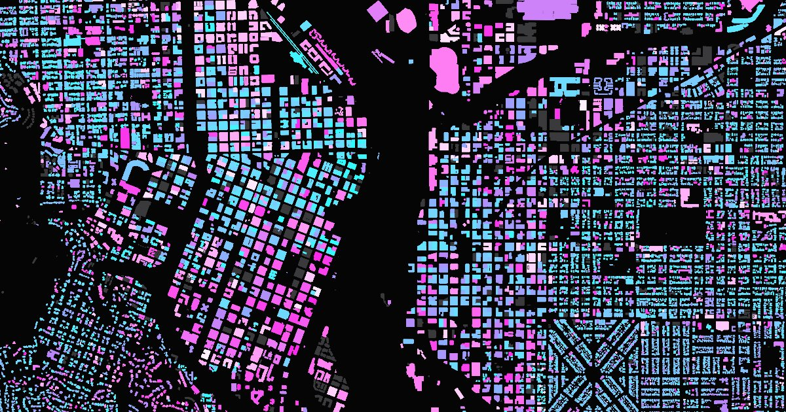

# Age of the City



This repo rebuilds the 2013 map ["Portland, Oregon: The Age of a City"](https://labratrevenge.com/)
by [Justin Palmer](https://github.com/caged)
using [PMTiles](https://github.com/protomaps/PMTiles) hosted on Cloudflare R2/Workers
and rendered with MapLibre GL JS.

## Data sources

The City of Portland [Open Data portal](https://gis-pdx.opendata.arcgis.com/)
provides these ArcGIS layers:

| Dataset | Exact service URL | Fields used |
| --- | --- | --- |
| Building Footprints | https://www.portlandmaps.com/od/rest/services/COP_OpenData_Property/MapServer/48 | `BLDG_ID`, `YEAR_BUILT`, `BLDG_USE`, `BLDG_SQFT`, `NUM_STORY` |
| Active Address Points | https://www.portlandmaps.com/od/rest/services/COP_OpenData_Property/MapServer/1272 | `ADDRESS_FULL`, address components, `IS_MAIN_ADDRESS`, `OBJECTID` |
| Neighborhood Boundaries | https://www.portlandmaps.com/od/rest/services/COP_OpenData_Boundary/MapServer/3 | `NAME` |

## Setup

Run `brew bundle` for `uv`, `tippecanoe`, and the `pmtiles` CLI,
and `npm ci` for site dependencies.
Python scripts declare dependencies with PEP 723 metadata and accept Python 3.11–3.13.
GIS workflows use 3.12; Python 3.14 lacks a wheel for pinned `pyogrio` 0.11.1.
Inputs and tiles stay in the ignored `data/` directory.

## 1) Download and process buildings

```bash
uv run scripts/process_buildings.py
```

This writes `data/inputs/{buildings,neighborhoods,addresses}.geojson`,
`data/buildings_cleaned.ndjson`, and `src/data/building-stats.json`.
Each run downloads fresh inputs unless overridden locally.
The script reads live pagination metadata and downloads all layers with `where=1=1`,
no spatial filter, and `orderByFields=OBJECTID` (or the declared object ID field).
It retries failed requests and rejects incomplete pages and duplicate IDs.
Before replacing an input, it checks feature and unique ID counts against
`returnCountOnly` queries before and after download, and prints all counts.
ArcGIS has no transaction across layers; retain inputs to reproduce a snapshot.
The complete regional footprint layer includes neighboring cities.
Address and neighborhood joins retain unmatched buildings.

Reuse all three saved inputs without network requests:

```bash
uv run scripts/process_buildings.py \
  --buildings data/inputs/buildings.geojson \
  --addresses data/inputs/addresses.geojson \
  --neighborhoods data/inputs/neighborhoods.geojson \
  --current-year 2026 \
  --output data/buildings_cleaned.ndjson \
  --stats-output src/data/building-stats.json
```

Overrides accept any GeoPandas-readable dataset with matching fields and a declared CRS.
`--input` is an alias for `--buildings`.
`--download-dir` changes the download directory.
The validation year defaults to the current calendar year.

Geometry repair and spatial joins use UTM zone 10N (`EPSG:32610`), in metres.
The script drops empty geometries, non-polygon footprints and boundaries,
and non-point addresses after repair.
It reports losses, WGS84 bounds, and join coverage, without simplifying footprints.

Neighborhoods contain footprint centroids; alphabetical order breaks overlap ties.
The address comes from a point covered by the footprint, including its boundary.
If none is available, the nearest point within 30 metres of the footprint is used.
Main addresses, then lowest object IDs, break containment or equal-distance ties.
Points without usable addresses are excluded.
Addresses use `ADDRESS_FULL`, including units,
or fall back to number, street name, and unit fields.
Nearest addresses can belong to another building.

| Tile property | Convention |
| --- | --- |
| `year_built` | Integer from 1700 through the validation year; otherwise `-1`. Fractional years are invalid. |
| `age_bucket` | Existing age bands from `pre-1900` through `2010-present`; `unknown` for year `-1`. |
| `bldg_id` | Source building ID as a string; empty string if absent. |
| `bldg_use` | Source use as a string; empty string if absent. |
| `bldg_sqft`, `num_story` | Positive finite numbers; missing, zero, negative, and invalid values become `-1`. Fractions are retained. |
| `address`, `neighborhood` | Strings; omitted when unknown. |

Statistics describe retained footprints before tiling.
The JSON contains `source`, `total`, `unknown`, `earliestYear`, `latestYear`, and `byDecade`,
and records `bounds` as `[west, south, east, north]` in WGS84.
The map pan limits, OG card validation, and Dataset metadata use these bounds.
Buildings outside Portland neighborhoods have no neighborhood value.
Year limits are `null` when no known years remain.
Counts are not deduplicated by `BLDG_ID`: these labels can repeat,
and selecting one can highlight multiple footprints.

Run the focused Python tests:

```bash
uv run scripts/test_process_buildings.py
```

## 2) Build and verify PMTiles

```bash
bash scripts/build_tiles.sh
pmtiles show data/portland_buildings.pmtiles
pmtiles verify data/portland_buildings.pmtiles
```

The build script runs this command:

```bash
tippecanoe \
  -o data/portland_buildings.pmtiles \
  -l buildings -n "Portland Building Ages" \
  --projection=EPSG:4326 -Z10 -z16 \
  --drop-densest-as-needed \
  -y year_built -y age_bucket -y bldg_id \
  -y bldg_use -y bldg_sqft -y num_story -y address -y neighborhood \
  -P -f data/buildings_cleaned.ndjson
```

Tiles start at city-scale zoom 10; MapLibre overzooms above 16.
Dense tiles can drop features; statistics still include all retained footprints.
Buildings are not coalesced, preserving distinct addresses.
The map requires the `buildings` layer and all listed properties.
`-P` reads features in parallel; `-f` replaces the archive.

The [refresh workflow](.github/workflows/refresh-buildings.yml) runs manually
with `workflow_dispatch` and from the default branch monthly on day 1 at 10:17 UTC.
It uses macOS and `brew bundle` to test transformations, rebuild data and statistics,
and build and verify the archive.
Artifacts retain PMTiles, statistics JSON, `pmtiles show` output, and SHA-256 hashes
for 30 days.
The workflow has no Cloudflare credentials and never publishes.

Before publication, download the artifact, inspect metadata, and verify hashes.
Update `src/data/building-stats.json` through a pull request.
R2 upload requires separate approval; coordinate it with deployment of matching statistics.
Keep the previous archive for rollback.

## Orientation layers

Water and roads use `data/orientation.pmtiles`, cropped from a daily
[Protomaps basemap build](https://docs.protomaps.com/basemaps/downloads)
of OpenStreetMap data.
Rebuild it manually; the monthly workflow excludes it:

```bash
bash scripts/build_orientation.sh            # newest build
bash scripts/build_orientation.sh 20261101   # a specific build, for a repeatable archive
```

The script extracts zooms 0 through 14 for the bounds in `src/data/building-stats.json`,
then uses `tile-join` to keep zooms 10 through 14,
the `water` and `roads` layers, and the properties the style reads.
Roads keep highways, major roads, and residential streets,
without paths, rail, service roads, or driveways.
Water keeps rivers, lakes, sloughs, and canals, without pools and fountains.
The archive is about 9 MB; MapLibre overzooms it above zoom 14.

The Worker serves archives by name, including `/tiles/orientation.json`.
Upload locally for development or remotely for deployment:

```bash
npx wrangler r2 object put ageofthe-city/orientation.pmtiles \
  --file=data/orientation.pmtiles --local
npx wrangler r2 object put ageofthe-city/orientation.pmtiles \
  --file=data/orientation.pmtiles --remote
```

Upload the archive to the remote bucket before you deploy
the first version of the site that reads `orientation.pmtiles`.

The style in `src/lib/orientation.ts` adds shorelines at zoom 12
and fades residential streets in from zoom 13.5 to 15.
Water and roads have no labels and are darker than unknown-age buildings.

## 3) Run the site locally

Astro pages live in `src/`; the Cloudflare Worker lives in `worker/`.
The Worker serves `dist/` assets and R2 tiles at the same origin:

- `/tiles/portland_buildings.json` returns TileJSON.
  Its tile URLs carry the archive's ETag as `?v=`,
  so a new archive gets new tile URLs.
- `/tiles/portland_buildings/{z}/{x}/{y}.mvt` returns a tile.
  Versioned tiles are cached for a year;
  a position with no buildings returns `204 No Content`.
- `www.ageofthe.city` redirects to `ageofthe.city` with a 308.

Wrangler runs `npm run build` before `dev` and `deploy` to build `dist/`
and check internal links for trailing slashes.
Node.js 22.23.4 or later is required.
`npm run check` type-checks the site and the Worker,
and `npm test` runs their unit tests.

Upload the tileset to local R2 and start the development server:

```bash
npx wrangler r2 object put ageofthe-city/portland_buildings.pmtiles \
  --file=data/portland_buildings.pmtiles --local
npm run dev
```

Open http://localhost:8787/.

## 4) Deploy to Cloudflare

The Worker `ageofthe-city` serves the custom domains
`ageofthe.city` and `www.ageofthe.city`,
and reads the tiles from the R2 bucket `ageofthe-city`.
The zone for `ageofthe.city` must be in the same Cloudflare account.
If your Wrangler login has access to more than one account,
set `CLOUDFLARE_ACCOUNT_ID` first.

```bash
npx wrangler r2 bucket create ageofthe-city
npx wrangler r2 object put ageofthe-city/portland_buildings.pmtiles \
  --file=data/portland_buildings.pmtiles --remote
npm run deploy
```

To publish a new tileset, upload it again with the same command.
The TileJSON is cached for five minutes,
then the page requests tiles with the new version.

Check the responses:

```bash
curl -I https://ageofthe.city/
curl -s https://ageofthe.city/tiles/portland_buildings.json
curl -I https://www.ageofthe.city/
```

## License and attribution

The [City of Portland Terms of Use for Open Data](https://www.portlandmaps.com/img/tos.pdf)
make data on the PortlandMaps Open Data website available under the
[Public Domain Dedication and License v1.0](http://www.opendatacommons.org/licenses/pddl/1.0/),
except where the data's page or metadata states otherwise.
The building footprints come from the City of Portland
Bureau of Planning and Sustainability,
and the page credits them.

The water and street lines come from OpenStreetMap
through a [Protomaps basemap build](https://docs.protomaps.com/basemaps/downloads).
OpenStreetMap data is available under the
[Open Database License](https://www.openstreetmap.org/copyright),
and the page credits OpenStreetMap contributors.
