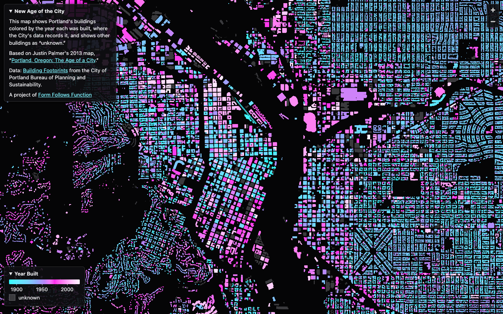

# New Age of the City



This repo rebuilds the 2013 map ["Portland, Oregon: The Age of a City"](https://labratrevenge.com/)
by [Justin Palmer](https://github.com/caged)
using [PMTiles](https://github.com/protomaps/PMTiles) hosted on Cloudflare R2/Workers
and rendered with MapLibre GL JS.

## Data sources

The rebuild uses these City of Portland ArcGIS Open Data layers.
The script queries their live metadata for pagination support and page size,
then downloads GeoJSON ordered by object ID.

| Dataset | Exact service URL | Fields used |
| --- | --- | --- |
| Building Footprints | https://www.portlandmaps.com/od/rest/services/COP_OpenData_Property/MapServer/48 | `BLDG_ID`, `YEAR_BUILT`, `BLDG_USE`, `BLDG_SQFT`, `NUM_STORY` |
| Active Address Points | https://www.portlandmaps.com/od/rest/services/COP_OpenData_Property/MapServer/1272 | `ADDRESS_FULL`, address components, `IS_MAIN_ADDRESS`, `OBJECTID` |
| Neighborhood Boundaries | https://www.portlandmaps.com/od/rest/services/COP_OpenData_Boundary/MapServer/3 | `NAME` |

The [Open Data portal](https://gis-pdx.opendata.arcgis.com/)
provides the source catalog.
All three layers are downloaded in full with `where=1=1` and no spatial filter.
Every page uses `orderByFields=OBJECTID` (or the layer's declared object ID field).
Before processing, the script checks both feature count and unique object ID count
against `returnCountOnly` queries made before and after each download.
A mismatch stops the run before the downloaded file replaces the previous input.
The map keeps the complete regional footprint layer, including neighboring cities.
It does not clip buildings to the Portland city boundary.
Address and neighborhood joins add information without removing unmatched buildings.

## Workflow overview

1. Install tools with `brew bundle` and site dependencies with `npm ci`.
2. Download and process the three datasets with `uv`.
3. Build PMTiles at maximum zoom 16 with Tippecanoe.
4. Inspect the archive before uploading it to R2.

The Brewfile installs `uv`, `tippecanoe`, and the `pmtiles` CLI.
The Python scripts use self-contained PEP 723 dependency metadata.
GIS workflows select Python 3.12, which has wheels for the pinned GIS libraries.
The scripts accept Python 3.11 through 3.13; Python 3.14 is excluded because
`pyogrio` 0.11.1 does not provide a wheel for it.
Downloaded inputs and generated tiles stay in the ignored `data/` directory.

## 1) Download and process buildings

```bash
uv run scripts/process_buildings.py
```

This writes `data/inputs/{buildings,neighborhoods,addresses}.geojson`,
`data/buildings_cleaned.ndjson`, and `src/data/building-stats.json`.
Each run downloads fresh inputs unless a local override is supplied.
The script retries failed requests and rejects incomplete pages or duplicate object IDs.
It prints the service counts, downloaded counts, and unique object ID counts for each layer.
ArcGIS does not provide a transaction across layers; retain the downloaded files
when you need to reproduce the same input snapshot.

Reuse all three saved inputs without network requests:

```bash
uv run scripts/process_buildings.py \
  --buildings data/inputs/buildings.geojson \
  --addresses data/inputs/addresses.geojson \
  --neighborhoods data/inputs/neighborhoods.geojson \
  --current-year 2026 \
  --output data/buildings_cleaned.ndjson \
  --stats-output src/data/building-stats.json
```

Each override also accepts another GeoPandas-readable dataset with the same fields
and a declared CRS.
`--input` is an alias for `--buildings`.
`--download-dir` changes the download directory.
The validation year defaults to the current calendar year.

Geometry repair and all spatial joins use UTM zone 10N (`EPSG:32610`), in metres.
Empty geometries are dropped.
Footprints and boundaries must remain polygons after repair; addresses must remain points.
The script reports these losses, final bounds in WGS84,
and address and neighborhood coverage.
It does not simplify footprint geometry before tiling.

The neighborhood is the polygon that contains the footprint centroid.
Where neighborhood polygons overlap, the first name in alphabetical order wins.
The address comes from a point covered by the footprint, including its boundary.
If none is available, the nearest point within 30 metres of the footprint is used.
For multiple contained points or equal-distance matches, main addresses take
precedence, followed by the lowest object ID.
Points without a usable address are excluded before the joins.
`ADDRESS_FULL` supplies a single-line street address, including a unit when present.
If it is empty, the script combines the number, street name, and unit fields.
Nearby addresses can belong to another building; this fallback is an approximation.

| Tile property | Convention |
| --- | --- |
| `year_built` | Integer from 1700 through the validation year; otherwise `-1`. Fractional years are invalid. |
| `age_bucket` | Existing age bands from `pre-1900` through `2010-present`; `unknown` for year `-1`. |
| `bldg_id` | Source building ID as a string; empty string if absent. |
| `bldg_use` | Source use as a string; empty string if absent. |
| `bldg_sqft`, `num_story` | Positive finite numbers; missing, zero, negative, and invalid values become `-1`. Fractions are retained. |
| `address`, `neighborhood` | Strings; omitted when unknown. |

Statistics are computed from the final retained footprints, before tiling.
The JSON keeps `source`, `total`, `unknown`, `earliestYear`, `latestYear`, and `byDecade`,
and records `bounds` as `[west, south, east, north]` in WGS84.
The map pan limits, OG card validation, and Dataset metadata use these bounds.
Neighborhood coverage is limited to Portland neighborhood polygons;
regional buildings outside them remain in the data without a neighborhood value.
The year limits are `null` when no known years remain.
Counts describe footprints, not deduplicated building IDs.
The source `BLDG_ID` values are not unique across the region.
The pipeline preserves these labels and all footprints; selecting a repeated label
can highlight more than one footprint.

Run the focused Python tests:

```bash
uv run scripts/test_process_buildings.py
```

## 2) Build and verify PMTiles

```bash
bash scripts/build_tiles.sh
pmtiles show data/portland_buildings.pmtiles
pmtiles verify data/portland_buildings.pmtiles
```

The build script runs this command:

```bash
tippecanoe \
  -o data/portland_buildings.pmtiles \
  -l buildings -n "Portland Building Ages" \
  --projection=EPSG:4326 -Z10 -z16 \
  --drop-densest-as-needed \
  -y year_built -y age_bucket -y bldg_id \
  -y bldg_use -y bldg_sqft -y num_story -y address -y neighborhood \
  -P -f data/buildings_cleaned.ndjson
```

`-Z10` starts at city-scale zoom, omitting coarse zooms where footprints are too small to read.
`-z16` fixes the maximum zoom at 16; MapLibre can overzoom these tiles.
`--drop-densest-as-needed` limits dense tile sizes by dropping features as needed.
The source statistics include all retained footprints, even if tiling drops features.
The command does not coalesce buildings, which could combine distinct addresses.
Each `-y` flag retains a required property.
`-P` reads newline-delimited features in parallel, and `-f` replaces a previous archive.
The layer name remains `buildings`, as the map expects.

The [refresh workflow](.github/workflows/refresh-buildings.yml) runs manually
with `workflow_dispatch` and on the first day of each month at 10:17 UTC.
GitHub runs scheduled workflows from the default branch once the workflow is merged there.
It uses a macOS runner and `brew bundle`, tests the transformations,
rebuilds the data and statistics, and builds and verifies the archive.
The workflow stores the PMTiles archive, regenerated statistics JSON,
`pmtiles show` output, and SHA-256 hashes as an artifact for 30 days.
It uses no Cloudflare credentials and never uploads or deploys.

Download the artifact from the completed workflow run.
Inspect the archive metadata and verify its hashes before publication.
Open a pull request that updates `src/data/building-stats.json` from the artifact.
Uploading the archive to R2 is a separate approved operation;
coordinate it with deployment of the site containing the matching statistics.
Keep the previous archive available for rollback.

## 3) Run the site locally

The site is an Astro project at the repository root,
with its pages in `src/` and the Cloudflare Worker in `worker/`.
The Worker serves the Astro build in `dist/` as static assets
and the tiles from a PMTiles archive in R2, at the same origin:

- `/tiles/portland_buildings.json` returns TileJSON.
  Its tile URLs carry the archive's ETag as `?v=`,
  so a new archive gets new tile URLs.
- `/tiles/portland_buildings/{z}/{x}/{y}.mvt` returns a tile.
  Versioned tiles are cached for a year;
  a position with no buildings returns `204 No Content`.
- `www.ageofthe.city` redirects to `ageofthe.city` with a 308.

The build step (`npm run build`, which Wrangler runs before `dev` and `deploy`)
builds the Astro site into `dist/`.
Astro also checks that every internal link uses the site's one URL form,
with a trailing slash.
The build requires Node.js 22.23.4 or later.
`npm run check` type-checks the site and the Worker,
and `npm test` runs their unit tests.

Upload the tileset to local R2 and start the development server:

```bash
npm install
npx wrangler r2 object put ageofthe-city/portland_buildings.pmtiles \
  --file=data/portland_buildings.pmtiles --local
npm run dev
```

Open http://localhost:8787/.

## 4) Deploy to Cloudflare

The Worker `ageofthe-city` serves the custom domains
`ageofthe.city` and `www.ageofthe.city`,
and reads the tiles from the R2 bucket `ageofthe-city`.
The zone for `ageofthe.city` must be in the same Cloudflare account.
If your Wrangler login has access to more than one account,
set `CLOUDFLARE_ACCOUNT_ID` first.

```bash
npm install
npx wrangler r2 bucket create ageofthe-city
npx wrangler r2 object put ageofthe-city/portland_buildings.pmtiles \
  --file=data/portland_buildings.pmtiles --remote
npm run deploy
```

To publish a new tileset, upload it again with the same command.
The TileJSON is cached for five minutes,
then the page requests tiles with the new version.

Check the responses:

```bash
curl -I https://ageofthe.city/
curl -s https://ageofthe.city/tiles/portland_buildings.json
curl -I https://www.ageofthe.city/
```

## Costs

- R2 storage: $0.015/GB/month
- Worker requests: free tier includes 100K requests/day
- A typical 100GB tileset runs around $3-5/month, depending on usage

## License and attribution

The [City of Portland Terms of Use for Open Data](https://www.portlandmaps.com/img/tos.pdf)
make data on the PortlandMaps Open Data website available under the
[Public Domain Dedication and License v1.0](http://www.opendatacommons.org/licenses/pddl/1.0/),
except where the data's page or metadata states otherwise.
The building footprints come from the City of Portland
Bureau of Planning and Sustainability,
and the page credits them.
